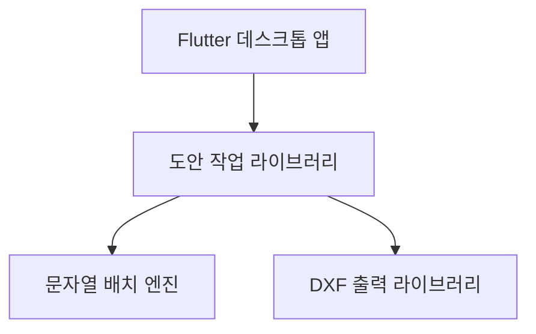

> 현재 앱 프로젝트는 로컬에서 r_edit로 생성하는 절차를 진행했다. 기존 앱을 재생성하지 않고 이 문서를 재개 참고로 사용한다.

# R-edit 저장소와 패키지 구조

제품 표시 이름은 **R-edit**다. 기존 프로그램을 계승하고 새 코드는 별도 저장소에서 처음부터 개발한다.
기존 저장소는 개인 계정에 있다는 사용자 확인을 반영한다. 개인 계정의 기존 저장소를 이동하거나 바꾸는 작업은 하지 않는다.
제품에 속하는 앱·업무 흐름·문서는 `r-edit` 이름을 공유하고, 독립 라이브러리는 실제 기능 이름을 쓴다.
`ORG`는 실제 GitHub 조직명으로 치환한다. 아래는 생성할 저장소의 기준이며 실제 원격 저장소를 생성한 결과가 아니다.

## 독립 개발 단위

| GitHub 저장소 | Dart 패키지명 | 책임 |
|---|---|---|
| `r-edit-docs` | 해당 없음 | 요구사항, 결정, 모듈 계약, 재개 안내, 검증 근거 |
| `r-edit-workflow` | `r_edit_workflow` | 도안 작업 모델, 수정·확인·저장 정책, 영향 대상 관리, JSON 입출력, 기능 연결 |
| `nameplate-text-layout` | `nameplate_text_layout` | 문구 분할·줄바꿈·자폭·크기·위치 계산, 공간 검사, 그룹 선택, 판정·진단 |
| `nameplate-dxf-export` | `nameplate_dxf_export` | 확정된 출력 자료를 DXF로 표현, 도형·편집 가능한 문자·인코딩 처리 |
| `r-edit` | `r_edit` | Flutter Windows 앱, 입력 표·미리보기·명령 연결, 플랫폼 기능 |

첫 시작은 문서 저장소와 `r-edit-workflow`다. 나머지는 해당 구현에 들어갈 때 생성한다.
세 라이브러리는 Flutter 의존성 없는 Dart 패키지로 시작하고 각자 `pubspec.yaml`, 공개 API, 시험, 변경 기록을 갖는다.
도안 작업 라이브러리는 업무의 한 단위이므로 모델과 저장 정책을 함께 소유한다. 처음부터 범용 공용 라이브러리나 별도 계약 저장소를 더 만들지 않는다.

## 의존 방향

도안 작업은 필요한 시점에 엔진·출력 라이브러리의 공개 API를 호출하고 자기 모델과 값을 변환한다.
첫 작업에서는 아직 없는 다른 저장소의 의존성을 선언하지 않는다. 엔진과 DXF는 Flutter와 도안 작업 저장 파일을 역으로 참조하지 않는다.
앱의 위젯 안에는 배치 알고리즘·JSON 직렬화·DXF 작성 로직을 두지 않는다.

| 경계 | 전달 내용 |
|---|---|
| 작업 → 엔진 | 원문·줄바꿈 지정·형상·영역·적용 규칙·폰트 측정 자료·탐색 조건 |
| 엔진 → 작업 | 줄별 배치, 원문 위치 연결, 판정·사유, 계산 식별 정보 |
| 작업 → DXF | 출력할 확정 문구·좌표·크기·자폭·형상과 수량 표현을 반영한 출력 자료 |
| DXF → 작업 | 생성 결과 또는 구체적인 출력 오류 |

수량·Drive 경로·고객 화면 상태는 배치 엔진 입력이 아니다.
출력 라이브러리는 글자를 다시 배치하지 않는다. 저장 파일은 엔진 내부 객체의 `toJson()`에 종속되지 않도록 작업 라이브러리 소유의 형식으로 변환한다.
폰트 측정값을 얻는 플랫폼 구현은 추후 경계를 정하고, 엔진은 명시적으로 제공된 측정 자료를 사용한다.

## 수정과 배포

엔진의 공개 입력·결과 계약을 유지하면 내부 알고리즘 수정으로 앱 화면과 파일 저장 코드를 고칠 필요를 줄일 수 있다.
공개 계약이 바뀌면 이를 사용하는 작업 라이브러리의 변환 코드도 함께 조정할 수 있다. 저장소 분리가 모든 변경의 영향을 없애지는 않는다.
라이브러리는 독립 시험·릴리스하고, 앱은 채택할 버전을 명시한다. 일반 Dart 의존성으로 연결한 새 엔진을 배포하려면 앱을 다시 빌드·배포한다.
실행 중 DLL 교체·별도 프로세스·플러그인 서버는 이번 구조의 전제가 아니다.

## 각 저장소의 기본 구조

| 경로 | 내용 |
|---|---|
| `README.md` | 역할, 공개 API 사용 예, 실행·시험 방법, 관련 저장소와 문서 기준 커밋 |
| `AGENTS.md` | 이 저장소에서 Junie가 지킬 범위와 명령 |
| `CHANGELOG.md` | 실제 변경과 호환성 영향 |
| `docs/contract.md` | 입력·출력 의미, 단위, 오류와 지원 범위 |
| `docs/next-step.md` | 현재 작동 범위, 마지막 확인, 다음 한 가지 작업 |
| `lib/<package>.dart` | 사용자가 가져갈 공개 진입점 |
| `lib/src/` | 패키지 내부 구현 |
| `test/` | 해당 패키지의 동작 계약 검증 |

몇 달 뒤 재개할 때는 README와 `docs/next-step.md`를 읽고 시험을 실행하면 현 상태를 파악할 수 있게 한다.
공개 API를 통한 패키지 사용을 기준으로 삼고 다른 저장소가 `lib/src/`를 직접 가져다 쓰지 않게 한다.
